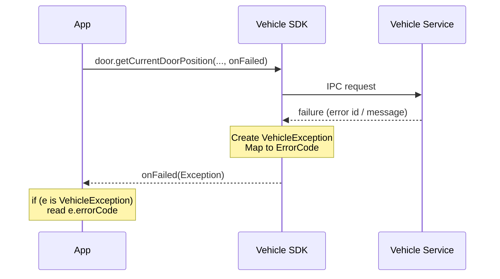

# 04. SDK 사용 가이드 — Overview & Vehicle SDK

Pleos Connect SDK 개요와 Vehicle SDK(차량 상태 조회·제어) 사용 가이드 원문.

## 목차

- [Overview](#overview)
- [Introduction](#introduction)
- [Importing Vehicle SDK](#importing-vehicle-sdk)
- [Declaring permission](#declaring-permission)
- [Obtaining a domain object](#obtaining-a-domain-object)
- [Capability](#capability)
- [Get](#get)
- [Set](#set)
- [Callback](#callback)
- [Error code](#error-code)


---

## Overview

> 원문: https://document.pleos.ai/docs/pleos-only/connect-sdk-pleos/

Pleos Connect SDK는 Pleos Connect 환경에서 동작하는 인포테인먼트 애플리케이션 개발을 위한 통합 개발 도구입니다. 구글 Android Automotive OS(AAOS)를 기반으로 구축되어 표준화된 인터페이스를 제공하며, 복잡한 하드웨어 연동 과정 없이도 차량 관련 앱을 효율적으로 개발할 수 있도록 지원합니다. 개발자는 SDK에서 제공하는 강력한 API와 에뮬레이터를 활용하여 다음과 같은 핵심 기능을 구현할 수 있습니다.

- 차량 제어 및 모니터링: Vehicle SDK, FusedLocation SDK
- 내비게이션 및 음성 서비스: NaviHelper SDK, SpeechToText SDK, TextToSpeech SDK

[이미지 설명 필요: Pleos Connect SDK 구성도 — 좌측 Pleos Connect SDK 묶음(Vehicle, NaviHelper, TextToSpeech, SpeechToText, FusedLocation SDK). 3rd Party Application A·B가 각각 Pleos Connect SDK를 탑재하고 Pleos Connect Automotive Services(Account, Vehicle, Navi, Speech, FusedLocation Service)와 양방향 통신하며, 그 아래에 Pleos Connect OS가 있음]

### Modules

Pleos Connect SDK는 Vehicle SDK, NaviHelper SDK, TextToSpeech SDK, SpeechToText SDK, FusedLocation SDK로 구성됩니다.

- **Vehicle SDK** : 차량 상태 조회와 차량 제어를 위한 API를 제공합니다.
- **NaviHelper SDK** : 경로 안내 제어와 내비게이션 정보 조회를 위한 API를 제공합니다.
- **TextToSpeech SDK** : 음성 합성(TextToSpeech) API를 제공합니다.
- **SpeechToText SDK** : 음성 인식(SpeechToText) API를 제공합니다.
- **FusedLocation SDK** : 차량의 위치 정보 API를 제공합니다.

### API policy

Pleos Connect SDK의 API 정책은 동일하거나 유사한 기능의 API가 Android Automotive OS에 존재할 경우 플랫폼 파편화를 최소화하기 위해 Android Automotive에 align하는 것을 원칙으로 합니다. 향후 Pleos Connect Vehicle SDK로 제공되던 기능이 Android Automotive에 수용될 경우 해당 기능은 최소 2개 major version 동안 backward compatibility를 보장하고 그 이후의 유지·변경·제거 여부는 별도 정책과 릴리스 노트를 통해 안내합니다.

> [WARNING]
>
> Vehicle SDK에서 API 지원 여부는 도메인별 `checkXXXCapabilities` API로 확인할 수 있습니다.
> API 사용 시에는 필요한 퍼미션을 앱에 선언해야 하며, 퍼미션은 Pleos App Market과 사전 협의 및 승인된 범위 내에서만 사용할 수 있습니다. 승인되지 않은 퍼미션을 선언하거나 해당 API를 호출하는 경우 앱 심사를 통과할 수 없습니다.
>
> - `checkXXXCapabilities` 사용 방법은 [도메인 Capability 확인](https://document.pleos.ai/docs/pleos-only/connect-sdk-pleos/Vehicle/check-capability)을 참조하세요.
> - 앱 심사 기준에 대한 자세한 내용은 [App Review Guidelines](https://document.pleos.ai/docs/pleos-only/distribute/app-review-guide/review-functionality-performance-stability#sdk-api-review)를 참조하세요.


---

## Introduction

> 원문: https://document.pleos.ai/docs/pleos-only/connect-sdk-pleos/Vehicle/intro

### Vehicle SDK 소개

Vehicle SDK는 차량 정보 조회 및 제어를 위한 API를 제공합니다. 3rd party 앱은 Vehicle SDK를 통해 Pleos Connect의 Vehicle Service에 연결합니다. Vehicle Service는 Android Automotive OS 위에서 동작하며, 3rd party 앱은 Vehicle SDK API로 차량 정보 조회 및 제어를 요청하고 Vehicle Service가 이를 처리합니다.

[이미지 설명 필요: 계층도 — 3rd Party Application 안의 Vehicle SDK → (화살표) Pleos Connect OS 안의 Vehicle Service, 최하단 Android Automotive OS]

> [INFO]
>
> 이 가이드는 Vehicle SDK v2.3.2과 Vehicle Service v2.3.21을 기준으로 작성되었습니다.

### 진입점과 도메인 구조

Vehicle SDK API는 Brake, CarInfo, Display, Door, DrivingMode, EvBattery, Fuel, HVAC, Light 등 도메인별 인터페이스로 제공됩니다. [`Door`](https://document.pleos.ai/docs/pleos-only/connect-sdk-pleos/Vehicle/vehicle/ai.pleos.playground.vehicle.api/door/entry), [`Brake`](https://document.pleos.ai/docs/pleos-only/connect-sdk-pleos/Vehicle/vehicle/ai.pleos.playground.vehicle.api/brake/entry) 같은 도메인 객체는 직접 생성하지 않고, Vehicle SDK의 진입점인 [`Vehicle`](https://document.pleos.ai/docs/pleos-only/connect-sdk-pleos/Vehicle/vehicle/ai.pleos.playground.vehicle/vehicle/entry) 인스턴스의 [`getDoor()`](https://document.pleos.ai/docs/pleos-only/connect-sdk-pleos/Vehicle/vehicle/ai.pleos.playground.vehicle/vehicle/get-door), [`getBrake()`](https://document.pleos.ai/docs/pleos-only/connect-sdk-pleos/Vehicle/vehicle/ai.pleos.playground.vehicle/vehicle/get-brake)와 같은 `getXxx()`로만 얻습니다. 획득한 도메인 객체에서는 capability·get·set·callback API를 호출합니다. Capability(`checkXXXCapabilities`)는 기능 지원 여부와 허용 값 범위를 확인하고, get은 현재 값을 조회하며, set은 값을 설정합니다. Callback은 리스너를 등록해 상태 변화를 구독합니다.

차량 서비스 연결은 [`initialize()`](https://document.pleos.ai/docs/pleos-only/connect-sdk-pleos/Vehicle/vehicle/ai.pleos.playground.vehicle/vehicle/initialize)로 시작하고, 사용이 끝나면 [`release()`](https://document.pleos.ai/docs/pleos-only/connect-sdk-pleos/Vehicle/vehicle/ai.pleos.playground.vehicle/vehicle/release)로 해제합니다. 차량 통신은 IPC이므로 capability·get·set 결과는 즉시 반환되지 않고 `onComplete`·`onFailed` 비동기 람다로 전달됩니다. 비동기 콜백이 끝나기 전에 [`release()`](https://document.pleos.ai/docs/pleos-only/connect-sdk-pleos/Vehicle/vehicle/ai.pleos.playground.vehicle/vehicle/release)를 호출하지 않도록 주의해 주시기 바랍니다.

| 도메인 | 설명 |
| --- | --- |
| Brake | 브레이크 페달, 주차 브레이크 상태 조회 |
| CarInfo | 차량 기본 정보(외부 크기, 제조사, 연식 등) 조회 |
| Display | 인포테인먼트 표시 데이터 단위(온도 단위 등) 조회/설정 |
| Door | 도어 열림/닫힘, 잠금/해제 제어 및 상태 조회 |
| DrivingMode | 드라이브 모드, 크루즈 컨트롤 정보 조회 |
| EvBattery | EV 배터리·충전 상태 및 전비(효율) 조회 |
| Fuel | 연비 등 연료 관련 정보 조회 |
| HVAC | 난방·환기·공조(온도, 풍량, 습도 등) 제어 및 조회 |
| Light | 조명 상태 조회 및 앰비언트 라이트 등 제어 |
| Odometer | 총 주행 거리, 트립 주행 거리/시간, 주행 거리 단위 조회 |
| Safety | 차량 경고(Warning) 정보 조회 |
| Seat | 좌석 위치·각도·기능 제어 및 조회 |
| SideMirror | 사이드미러 열선 상태 조회/설정 |
| Steeringwheel | 핸들(스티어링휠) 상태, 열선 조회/제어 |
| Tire | 타이어 상태 조회 |
| Toll | ETCS(하이패스) 음성 안내 음량 등 조회/설정 |
| TurnSignal | 방향 지시등 상태 조회 |
| Window | 창문 제어 및 상태 조회 |
| Wiper | 와이퍼 제어 및 상태 조회 |

### Emulator setup

Vehicle SDK는 Pleos Connect Emulator 환경에서 개발 및 검증합니다. 아래 순서로 개발 환경을 준비하세요.

1. [소프트웨어 개발 환경 요구사항 확인](https://document.pleos.ai/docs/connect/guide/getting-started/application-development/setup-connect-sdk-emulator#소프트웨어-개발-환경)
2. [Pleos Connect Emulator 설치](https://document.pleos.ai/docs/connect/guide/getting-started/application-development/setup-connect-sdk-emulator#installing-the-pleos-connect-emulator)
3. [AVD 생성 및 실행](https://document.pleos.ai/docs/connect/guide/getting-started/application-development/setup-connect-sdk-emulator#setting-up-the-emulator)
4. [Pleos Connect Virtual Console 설정](https://document.pleos.ai/docs/connect/guide/getting-started/application-development/use-vehicle-emulator)
5. [마이크 접근 설정](https://document.pleos.ai/docs/connect/guide/getting-started/application-development/configure-pleos-connect-emulator#마이크-접근-설정)
6. [Cold boot 설정](https://document.pleos.ai/docs/connect/guide/getting-started/application-development/configure-pleos-connect-emulator#cold-boot-설정)

### 다음 단계

1. [도메인 객체 획득](https://document.pleos.ai/docs/pleos-only/connect-sdk-pleos/Vehicle/obtain-domain-object): 도메인 객체를 획득하고 Get·Set·Callback·Capability API를 호출하는 방법
2. [Permission](https://document.pleos.ai/docs/pleos-only/connect-sdk-pleos/Vehicle/vehicle-permission): 도메인별 퍼미션
3. [Error code](https://document.pleos.ai/docs/pleos-only/connect-sdk-pleos/Vehicle/vehicle-error-code): 오류 코드 및 `onFailed` 처리
4. [API Reference](https://document.pleos.ai/docs/pleos-only/connect-sdk-pleos/Vehicle/entry): Vehicle SDK API 명세
5. [Vehicle SDK Sample App 사용 가이드](https://document.pleos.ai/docs/pleos-only/tutorial/vehicle-sdk-sample-app)


---

## Importing Vehicle SDK

> 원문: https://document.pleos.ai/docs/pleos-only/connect-sdk-pleos/Vehicle/project-setup

Vehicle SDK 사용을 위해 SDK 의존성을 설정합니다. 퍼미션 설정은 [Permission](https://document.pleos.ai/docs/pleos-only/connect-sdk-pleos/Vehicle/vehicle-permission)을 참조하세요.

### Maven 저장소 등록

SDK를 내려받을 Maven 저장소를 앱 프로젝트의 `settings.gradle`에 등록합니다.

[탭: Kotlin]

```kotlin
dependencyResolutionManagement {
    ...
    repositories {
        maven {
            url = uri("https://nexus-playground.pleos.ai/repository/maven-releases/")
        }
        ...
    }
}
```

[탭: Groovy]

```groovy
dependencyResolutionManagement {
    ...
    repositories {
        ...
        maven {
            url "https://nexus-playground.pleos.ai/repository/maven-releases/"
        }
        ...
    }
}
```

### SDK 의존성 추가

앱 모듈의 `build.gradle`에 SDK 의존성을 선언합니다.

[탭: Kotlin]

```kotlin
dependencies {
    implementation("ai.pleos.playground:Vehicle:2.3.2")
}
```

[탭: Groovy]

```groovy
dependencies {
    implementation "ai.pleos.playground:Vehicle:2.3.2"
}
```


---

## Declaring permission

> 원문: https://document.pleos.ai/docs/pleos-only/connect-sdk-pleos/Vehicle/vehicle-permission

Vehicle SDK API는 Android 매니페스트에 Pleos 차량 퍼미션을 선언해야 호출할 수 있습니다. 각 API의 `@RequiresPermission` 어노테이션과 상수 정의는 [PleosPermission](https://document.pleos.ai/docs/pleos-only/connect-sdk-pleos/Vehicle/vehicle/ai.pleos.playground.vehicle.constant/pleos-permission/entry)을 참조하세요.

### 퍼미션 종류

[PleosPermission](https://document.pleos.ai/docs/pleos-only/connect-sdk-pleos/Vehicle/vehicle/ai.pleos.playground.vehicle.constant/pleos-permission/entry) 상수는 접두사로 구분됩니다. 매니페스트에는 `pleos.car.permission.{상수명}` 형식으로 선언합니다.

| 접두사 | 예시 | 용도 |
| --- | --- | --- |
| `CAR_*` | `CAR_DOORS` → `pleos.car.permission.CAR_DOORS` | 도메인 데이터 조회(get) |
| `CONTROL_CAR_*` | `CONTROL_CAR_DOORS` | 도메인 제어(set) |

### 도메인별 대표 퍼미션 (`CAR_*`)

아래는 도메인과 대표적으로 연결되는 조회용 퍼미션입니다. 세부 API마다 요구 퍼미션이 다를 수 있으므로, 호출 전 해당 함수의 `@RequiresPermission`을 확인하세요.

| 도메인 | PleosPermission 상수 | 매니페스트 `android:name` |
| --- | --- | --- |
| Door | `CAR_DOORS` | `pleos.car.permission.CAR_DOORS` |
| Window, Wiper | `CAR_WINDOWS` | `pleos.car.permission.CAR_WINDOWS` |
| HVAC | `CAR_CLIMATE` | `pleos.car.permission.CAR_CLIMATE` |
| DrivingMode, Brake, Odometer | `CAR_DRIVE` | `pleos.car.permission.CAR_DRIVE` |
| EvBattery, Fuel | `CAR_ENERGY` | `pleos.car.permission.CAR_ENERGY` |
| CarInfo, Display | `CAR_INFO` | `pleos.car.permission.CAR_INFO` |
| Light, TurnSignal | `CAR_LIGHTS` | `pleos.car.permission.CAR_LIGHTS` |
| SideMirror | `CAR_MIRRORS` | `pleos.car.permission.CAR_MIRRORS` |
| Safety, Tire | `CAR_SAFETY` | `pleos.car.permission.CAR_SAFETY` |
| Seat | `CAR_SEATS` | `pleos.car.permission.CAR_SEATS` |
| Toll | `CAR_TOLL` | `pleos.car.permission.CAR_TOLL` |

### 퍼미션 선언 예시

사용하는 도메인에 맞는 퍼미션만 선언하면 됩니다. 의존성 추가는 [Importing Vehicle SDK](https://document.pleos.ai/docs/pleos-only/connect-sdk-pleos/Vehicle/project-setup)를 참조하세요.

AndroidManifest.xml

```xml
<?xml version="1.0" encoding="utf-8"?>
<manifest xmlns:android="http://schemas.android.com/apk/res/android">

    <uses-permission android:name="pleos.car.permission.CAR_DOORS" />
    <uses-permission android:name="pleos.car.permission.CAR_INFO" />

    <!-- 사용하는 도메인에 맞는 퍼미션만 선언 -->

</manifest>
```

### 퍼미션 누락 시

퍼미션이 없으면 API `onFailed`에 `Exception`이 전달되며, `VehicleException`인 경우 `ERROR_SECURITY_PERMISSION`에 해당할 수 있습니다. 처리 방법은 [Error code](https://document.pleos.ai/docs/pleos-only/connect-sdk-pleos/Vehicle/vehicle-error-code)를 참조하세요.

> **[실측 검증 2026-11-05]** 권한이 없을 때 실제로 온 것은 `VehicleException`이 아니라 `SecurityException`(메시지 `"<메서드 이름> need Permission"`)입니다. `e is SecurityException`으로 판별하세요. `VehicleException`은 공개 클래스가 아니라 `is` 검사가 컴파일되지 않습니다([11-sdk-verification.md](11-sdk-verification.md) 2-2).


---

## Obtaining a domain object

> 원문: https://document.pleos.ai/docs/pleos-only/connect-sdk-pleos/Vehicle/obtain-domain-object

Vehicle SDK API는 진입점 [`Vehicle`](https://document.pleos.ai/docs/pleos-only/connect-sdk-pleos/Vehicle/vehicle/ai.pleos.playground.vehicle/vehicle/entry)에서 도메인 객체를 얻은 뒤, 그 객체에서 네 가지 타입(Get·Set·Callback·Capability)의 API를 호출하는 방식으로 사용합니다. 도메인 구조는 [Introduction](https://document.pleos.ai/docs/pleos-only/connect-sdk-pleos/Vehicle/intro#%EC%A7%84%EC%9E%85%EC%A0%90%EA%B3%BC-%EB%8F%84%EB%A9%94%EC%9D%B8-%EA%B5%AC%EC%A1%B0)을 참조하세요. 퍼미션은 [Permission](https://document.pleos.ai/docs/pleos-only/connect-sdk-pleos/Vehicle/vehicle-permission)을, 오류 처리는 [Error code](https://document.pleos.ai/docs/pleos-only/connect-sdk-pleos/Vehicle/vehicle-error-code)를 참조하세요.

[`Vehicle`](https://document.pleos.ai/docs/pleos-only/connect-sdk-pleos/Vehicle/vehicle/ai.pleos.playground.vehicle/vehicle/entry) 인스턴스를 생성하고 `initialize()`로 차량 서비스에 연결한 뒤, `getDoor()`·`getDisplay()`와 같은 `getXxx()`로 도메인 객체를 얻습니다. 도메인 객체에서 Get·Set·Callback·Capability API를 호출하며, 사용이 끝나면 `release()`로 리소스를 해제합니다.

차량 통신은 IPC이므로 get·set·capability 결과는 즉시 반환되지 않고 `onComplete`·`onFailed` 콜백으로 비동기 전달됩니다. 비동기 콜백이 끝나기 전에 `release()`를 호출하지 않도록 주의하세요.

[탭: Kotlin]

```kotlin
// Vehicle 인스턴스 생성 후 초기화
val vehicle = Vehicle(context)
vehicle.initialize()

// getXxx()로 도메인 객체 획득
val door = vehicle.getDoor()

// door 객체에서 Get / Set / Callback / Capability API 호출
// ...

// 사용 종료 후 리소스 해제
vehicle.release()
```

[탭: Java]

```java
// Vehicle 인스턴스 생성 후 초기화
Vehicle vehicle = new Vehicle(context);
vehicle.initialize();

// getXxx()로 도메인 객체 획득
Door door = vehicle.getDoor();

// door 객체에서 Get / Set / Callback / Capability API 호출
// ...

// 사용 종료 후 리소스 해제
vehicle.release();
```

### 네 가지 API 타입

| 타입 | 하는 일 | 결과 전달 | 문서 |
| --- | --- | --- | --- |
| Capability | 기능 지원 여부·허용 범위 확인 | `onComplete(config, areaMap)` / `onFailed` | [Capability](https://document.pleos.ai/docs/pleos-only/connect-sdk-pleos/Vehicle/check-capability) |
| Get | 현재 값 조회 | `onComplete(값)` / `onFailed` | [Get](https://document.pleos.ai/docs/pleos-only/connect-sdk-pleos/Vehicle/get-property) |
| Set | 값 설정 | `onFailed`(실패 시) | [Set](https://document.pleos.ai/docs/pleos-only/connect-sdk-pleos/Vehicle/set-property) |
| Callback | 상태 변화 구독 | 리스너 `onXxxUpdated` / `onFailed` | [Callback](https://document.pleos.ai/docs/pleos-only/connect-sdk-pleos/Vehicle/callback) |


---

## Capability

> 원문: https://document.pleos.ai/docs/pleos-only/connect-sdk-pleos/Vehicle/check-capability

> **[실측 검증 2026-11-05]** 예제의 `if (e is VehicleException)` 분기는 컴파일되지 않습니다. [Error code](#error-code)의 검증 메모를 참고하세요.

`checkXxxCapabilities`로 기능 지원 여부와 허용 범위를 확인합니다. `onComplete`는 기능 단위 지원 정보를 반환합니다. 반환 형태는 API마다 다르며, 공통 모델은 [capability 패키지](https://document.pleos.ai/docs/pleos-only/connect-sdk-pleos/Vehicle/vehicle/ai.pleos.playground.vehicle.api.model.capability/entry)를 참조하세요. 도메인 객체 획득은 [Obtaining a domain object](https://document.pleos.ai/docs/pleos-only/connect-sdk-pleos/Vehicle/obtain-domain-object)를, 상세 API 명세는 [API Reference](https://document.pleos.ai/docs/pleos-only/connect-sdk-pleos/Vehicle/entry)를 참조하세요.

이 문서 트리는 `CapabilityConfig`를 함께 반환하는 capability API를 기준으로 설명합니다.

| 타입 | 설명 |
| --- | --- |
| [CapabilityConfig](https://document.pleos.ai/docs/pleos-only/connect-sdk-pleos/Vehicle/vehicle/ai.pleos.playground.vehicle.api.model.capability/capability-config/entry) | 기능 단위 접근 수준([AccessType](https://document.pleos.ai/docs/pleos-only/connect-sdk-pleos/Vehicle/vehicle/ai.pleos.playground.vehicle.api.model.capability/access-type/entry): `NONE`, `READ`, `WRITE`, `READ_WRITE`) |
| [AreaBounds](https://document.pleos.ai/docs/pleos-only/connect-sdk-pleos/Vehicle/vehicle/ai.pleos.playground.vehicle.api.model.capability/area-bounds/entry) | 영역별 허용 값 범위(`minValue`, `maxValue`) |
| `Map<Area, AreaBounds>` | 영역(예: [DoorArea](https://document.pleos.ai/docs/pleos-only/connect-sdk-pleos/Vehicle/vehicle/ai.pleos.playground.vehicle.api.model.area/door-area/entry))별 `AreaBounds` 맵 |

아래 예제는 [`Vehicle`](https://document.pleos.ai/docs/pleos-only/connect-sdk-pleos/Vehicle/vehicle/ai.pleos.playground.vehicle/vehicle/entry) 인스턴스(`vehicle`)를 이미 초기화했다고 가정합니다.

[탭: Kotlin]

```kotlin
val door = vehicle.getDoor()
door.checkDoorPositionCapabilities(
  onComplete = { config, areaMap ->
    when (config.accessType) {
      AccessType.READ, AccessType.READ_WRITE -> {
        val bounds = areaMap[DoorArea(DoorValue.ROW_1_LEFT)]
        // Use bounds?.minValue / bounds?.maxValue, then call getCurrentDoorPosition
      }
      else -> {
        // NONE or WRITE only — disable UI or use an alternate flow
      }
    }
  },
  onFailed = { e: Exception ->
    if (e is VehicleException) {
      // Capability lookup failed: e.errorCode
    }
  }
)
```

[탭: Java]

```java
Door door = vehicle.getDoor();
door.checkDoorPositionCapabilities(
  (config, areaMap) -> {
    if (config.getAccessType() == AccessType.READ
        || config.getAccessType() == AccessType.READ_WRITE) {
      AreaBounds<Integer> bounds = areaMap.get(new DoorArea(DoorValue.ROW_1_LEFT));
      // Use bounds.getMinValue() / bounds.getMaxValue(), then call getCurrentDoorPosition
    } else {
      // NONE or WRITE only — disable UI or use an alternate flow
    }
    return Unit.INSTANCE;
  },
  e -> {
    if (e instanceof VehicleException) {
      // Capability lookup failed: ((VehicleException) e).getErrorCode()
    }
    return Unit.INSTANCE;
  }
);
```


---

## Get

> 원문: https://document.pleos.ai/docs/pleos-only/connect-sdk-pleos/Vehicle/get-property

`getCurrentXxx`로 차량 상태 및 설정 값을 조회합니다. 결과는 `onComplete(값)` / `onFailed`로 비동기 전달됩니다. 도메인 객체 획득은 [Obtaining a domain object](https://document.pleos.ai/docs/pleos-only/connect-sdk-pleos/Vehicle/obtain-domain-object)를, 상세 API 명세는 [API Reference](https://document.pleos.ai/docs/pleos-only/connect-sdk-pleos/Vehicle/entry)를 참조하세요.

아래 예제는 [`Vehicle`](https://document.pleos.ai/docs/pleos-only/connect-sdk-pleos/Vehicle/vehicle/ai.pleos.playground.vehicle/vehicle/entry) 인스턴스(`vehicle`)를 이미 초기화했다고 가정합니다.

[탭: Kotlin]

```kotlin
val door = vehicle.getDoor()
door.getCurrentDoorPosition(
  area = DoorArea(DoorValue.ROW_1_LEFT),
  onComplete = { pos: Int? ->
    // do something
  },
  onFailed = { e: Exception ->
    // do something
  }
)

val display = vehicle.getDisplay()
display.getCurrentTemperatureDisplayUnit(
  onComplete = { unit: TemperatureUnit? ->
    // do something
  },
  onFailed = { e: Exception ->
    // do something
  }
)
```

[탭: Java]

```java
Door door = vehicle.getDoor();
door.getCurrentDoorPosition(
  new DoorArea(DoorValue.ROW_1_LEFT),
  pos -> {
    // do something
    return Unit.INSTANCE;
  },
  e -> {
    // do something
    return Unit.INSTANCE;
  }
);

Display display = vehicle.getDisplay();
display.getCurrentTemperatureDisplayUnit(
  unit -> {
    // do something
    return Unit.INSTANCE;
  },
  e -> {
    // do something
    return Unit.INSTANCE;
  }
);
```


---

## Set

> 원문: https://document.pleos.ai/docs/pleos-only/connect-sdk-pleos/Vehicle/set-property

`setXxx`로 차량 상태 및 설정 값을 변경합니다. 실패 시 `onFailed`로 전달됩니다. 도메인 객체 획득은 [Obtaining a domain object](https://document.pleos.ai/docs/pleos-only/connect-sdk-pleos/Vehicle/obtain-domain-object)를, 상세 API 명세는 [API Reference](https://document.pleos.ai/docs/pleos-only/connect-sdk-pleos/Vehicle/entry)를 참조하세요.

아래 예제는 [`Vehicle`](https://document.pleos.ai/docs/pleos-only/connect-sdk-pleos/Vehicle/vehicle/ai.pleos.playground.vehicle/vehicle/entry) 인스턴스(`vehicle`)를 이미 초기화했다고 가정합니다.

[탭: Kotlin]

```kotlin
val door = vehicle.getDoor()
door.setDoorPosition(
  area = DoorArea(DoorValue.ROW_1_LEFT),
  value = 1, // Integer type
  onFailed = { e: Exception ->
    // do something
  }
)
```

[탭: Java]

```java
Door door = vehicle.getDoor();
door.setDoorPosition(
  new DoorArea(DoorValue.ROW_1_LEFT),
  1,
  e -> {
    // do something
    return Unit.INSTANCE;
  }
);
```


---

## Callback

> 원문: https://document.pleos.ai/docs/pleos-only/connect-sdk-pleos/Vehicle/callback

> **[실측 검증 2026-11-05]** 아래 Kotlin 예제의 `registerDoorPosition(doorPositionListener = …)`는 Vehicle 2.3.2에서 컴파일되지 않습니다. 실제 시그니처는 `registerDoorPosition(area: DoorArea, listener: DoorPositionListener)`입니다(`unregister…`도 같음). → [11-sdk-verification.md](11-sdk-verification.md)

`registerXxx` / `unregisterXxx`로 리스너를 등록·해제해 차량 상태 값의 변화를 구독합니다. 등록한 값이 변경되면 리스너의 `onXxxUpdated`로, 실패 시 `onFailed`로 전달됩니다. 도메인 객체 획득은 [Obtaining a domain object](https://document.pleos.ai/docs/pleos-only/connect-sdk-pleos/Vehicle/obtain-domain-object)를, 상세 API 명세는 [API Reference](https://document.pleos.ai/docs/pleos-only/connect-sdk-pleos/Vehicle/entry)를 참조하세요.

아래 예제는 [`Vehicle`](https://document.pleos.ai/docs/pleos-only/connect-sdk-pleos/Vehicle/vehicle/ai.pleos.playground.vehicle/vehicle/entry) 인스턴스(`vehicle`)를 이미 초기화했다고 가정합니다.

[탭: Kotlin]

```kotlin
// Create callback listener
val callbackListener = object : DoorPositionListener {
  override fun onPositionUpdated(pos: Int?) {
    // do something
  }

  override fun onFailed(e: Exception) {
    // do something
  }
}

val door = vehicle.getDoor()

// register callback
door.registerDoorPosition(
  doorPositionListener = callbackListener
)
// unregister callback
door.unregisterDoorPosition(
  doorPositionListener = callbackListener
)
```

[탭: Java]

```java
// Create callback listener
DoorPositionListener callbackListener = new DoorPositionListener() {
  @Override
  public void onPositionUpdated(@Nullable int pos) {
    // do something
  }

  @Override
  public void onFailed(@NonNull Exception e) {
    // do something
  }
};

Door door = vehicle.getDoor();

// register callback
door.registerDoorPosition(callbackListener);

// unregister callback
door.unregisterDoorPosition(callbackListener);
```


---

## Error code

> 원문: https://document.pleos.ai/docs/pleos-only/connect-sdk-pleos/Vehicle/vehicle-error-code

> **[실측 검증 2026-11-05]** Vehicle 2.3.2 AAR에서 `VehicleException`은 공개 클래스가 아니어서(난독화됨) `is VehicleException`이 컴파일되지 않습니다. 또 `ErrorCode`는 runtime 스코프 아티팩트(`vehicle-data`)에 있습니다. 에뮬레이터에서는 미지원 영역이면 일반 `Exception`(메시지에 원인), 권한이 없으면 `SecurityException`이 `onFailed`로 왔습니다. → [11-sdk-verification.md](11-sdk-verification.md)

Vehicle SDK가 제공하는 비동기 API는 onComplete와 onFailed 콜백으로 결과를 전달합니다.
앱에서는 onFailed로 받은 Exception이 VehicleException이면 errorCode로 ErrorCode 값을 확인합니다. 모든 onFailed가 VehicleException은 아닐 수 있습니다.

- onFailed 시그니처: Get/Set APIs, checkXXXCapabilities, VehicleListener는 모두 Kotlin 표준 [Exception](https://kotlinlang.org/api/core/kotlin-stdlib/kotlin/-exception/)을 사용합니다. ErrorCode가 콜백 인자로 직접 전달되지는 않습니다.
- ErrorCode 정의: ai.pleos.playground.vehicle.constant 패키지의 enum. Vehicle SDK 내부 오류 분류에 쓰이며, 공개 API에서는 VehicleException.errorCode로 노출됩니다.

사전에 [checkXXXCapabilities](https://document.pleos.ai/docs/pleos-only/connect-sdk-pleos/Vehicle/check-capability)로 미지원 호출을 줄이고, 퍼미션 오류는 [Permission](https://document.pleos.ai/docs/pleos-only/connect-sdk-pleos/Vehicle/vehicle-permission)을 확인하세요.

### 오류 전달 흐름



### onFailed 처리 예시

[탭: Kotlin]

```kotlin
door.getCurrentDoorPosition(
  area = DoorArea(DoorValue.ROW_1_LEFT),
  onComplete = { pos -> },
  onFailed = { e ->
    if (e is VehicleException) {
      when (e.errorCode) {
        ErrorCode.ERROR_NOT_SUPPORTED_PROPERTY,
        ErrorCode.ERROR_NOT_SUPPORTED_AREA -> { /* UI 비활성 */ }
        ErrorCode.ERROR_SECURITY_PERMISSION -> { /* 매니페스트 퍼미션 확인 */ }
        ErrorCode.ERROR_SERVICE_CONNECTION_FAILURE,
        ErrorCode.ERROR_INTERNAL_SERVICE -> { /* initialize·재시도 */ }
        else -> Log.e("Vehicle API 오류: ${e.errorCode} — ${e.message}")
      }
    } else {
      Log.e("Vehicle API 오류: ${e.message}")
    }
  }
)
```

[탭: Java]

```java
door.getCurrentDoorPosition(
  new DoorArea(DoorValue.ROW_1_LEFT),
  pos -> Unit.INSTANCE,
  e -> {
    if (e instanceof VehicleException) {
      ErrorCode code = ((VehicleException) e).getErrorCode();
      // code에 따라 분기 처리
    }
    return Unit.INSTANCE;
  }
);
```

### ErrorCode 목록

| ErrorCode | 설명 | 권장 처리 |
| --- | --- | --- |
| ERROR_NOT_SUPPORTED_PROPERTY | 해당 속성(기능) 미지원 | UI 비활성·대체 흐름 |
| ERROR_NOT_SUPPORTED_AREA | 해당 영역 미지원 | 영역 선택 변경 |
| ERROR_NOT_SUPPORTED_VALUE_TYPE | 지원하지 않는 값 타입 | 파라미터·타입 재확인 |
| ERROR_SECURITY_PERMISSION | 퍼미션 부족 | [Permission](https://document.pleos.ai/docs/pleos-only/connect-sdk-pleos/Vehicle/vehicle-permission)·@RequiresPermission 확인 |
| ERROR_SERVICE_CONNECTION_FAILURE | Vehicle 서비스 연결 실패 | initialize()·에뮬레이터 상태 확인 |
| ERROR_INTERNAL_SERVICE | 내부 서비스 오류 | 재시도·일시 오류 안내 |
| ERROR_DRIVING_RESTRICTED | 주행 중 기능 제한 | 주행 제한 안내 |
| ERROR_EMPTY_RESULT | 결과 없음 | 빈 상태 UI 처리 |
| ERROR_UNDEFINED | 정의되지 않은 오류 | 로그·재시도 |
